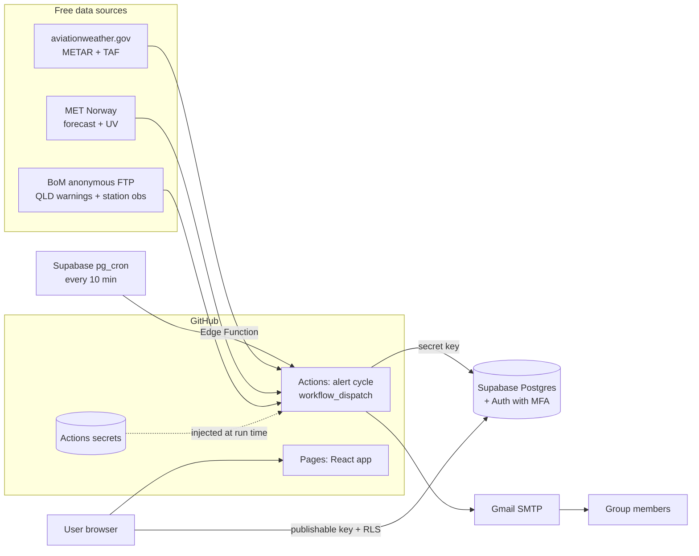

# Airport Weather Alert App (YBBN and YBCS)

A web dashboard and email alert service for ground handlers at Brisbane
(YBBN) and Cairns (YBCS). It is the open-source, zero-cost version of the
design in [the spec sheet](docs/Airport%20Weather%20Alert%20App%20–%20Spec%20Sheet%20(YBBN%20&%20YBCS).md).
It replaces Power Apps and SharePoint with React, Supabase and GitHub.

> **Advisory only.** Always follow official ATC, airport operator and company
> instructions.

## Features

| Feature | How it works |
| --- | --- |
| Login | Email + password **and** an authenticator app (TOTP MFA) for everyone. Public sign-up is off, and the database only answers a listed user who has passed MFA. |
| User management | Invite only, in **Settings → Users** (admins). Two roles: **Admin** (everything, including users) and **Power user** (mail groups, email sections, audit, dashboard). Admins can reset a password (email via the same Gmail SMTP) or MFA, change roles and remove users, and see only emails, never passwords. |
| User audit | **Settings → User audit** (admins) lists users added and removed, role changes, password resets and changes, MFA resets and email confirmations, each with a timestamp. Read-only. |
| Mail groups | Create groups and add or remove email addresses. |
| Alert toggles | Each group has switches for wind, thunderstorm, low visibility, heat, UV, tropical cyclone and stale data. It also has per-airport switches and a minimum level (Info, Watch, Warning or Stand-down). |
| Gmail alerts | Emails go out through Gmail SMTP (`smtp.gmail.com:465`) with an app password, Bcc to group members. An alert sends an email when it is raised or escalated, and again for the all-clear. |
| Email audit | Every send (or failed send) is logged with time, group, recipients, subject, body and error. The log is read-only in the app and kept for 12 months. |
| Live dashboard | Shows Brisbane, Cairns or both side by side. It has an alert banner, wind, visibility and cloud, temperature and QNH, UV with sun-protection band, BoM warnings, radar link, a 12-hour forecast, raw METAR and TAF, and feed health. It refreshes every 60 s and shows a stale-data banner. |
| Alert history | Lists alerts, newest first, with peak level and clear time for post-event review. |

## Architecture



- `src/domain`: pure rules and parsing, shared by the job and the web app.
- `src/job`: the scheduled alert cycle, which runs in GitHub Actions.
- `src/web`: the React + Tailwind admin app, served from GitHub Pages.
- `src/db`: database row mapping.
- `supabase/migrations`: the schema, with row-level security.

## Data sources (all free)

| Data | Source | Licence / terms |
| --- | --- | --- |
| Official METAR and TAF | [aviationweather.gov Data API](https://aviationweather.gov/data/api/) (no key) | US Government public data; 100 requests/min limit |
| Hourly forecast, clear-sky UV | [MET Norway Locationforecast](https://api.met.no/) (no key) | CC BY 4.0, attribution shown in the footer; commercial use allowed |
| Thunderstorm and cyclone warnings | BoM anonymous FTP (`ftp.bom.gov.au/anon/gen/fwo/IDQ*.amoc.xml`) | [BoM copyright terms](https://www.bom.gov.au/other/copyright.shtml); check the commercial-use question raised in the spec before go-live |
| Wind gusts (every gust, which METARs omit unless 10 kt above the mean wind) | BoM anonymous FTP (`ftp.bom.gov.au/anon/gen/fwo/IDQ60920.xml`, Brisbane 94578 and Cairns 94287 stations) | [BoM copyright terms](https://www.bom.gov.au/other/copyright.shtml); same terms as the warnings |

Compared with the spec, this build gets **official METAR and TAF at no cost**:
the spec's paid upgrade was only needed for Power Automate's premium HTTP
action. Open-Meteo was considered and rejected because its free tier is for
non-commercial use only.

## Getting started

- **Deploy it:** follow [docs/SETUP.md](docs/SETUP.md).
- **Hosting options and why this one was chosen:** see [docs/HOSTING.md](docs/HOSTING.md).
- **Secrets and security model:** see [docs/SECURITY.md](docs/SECURITY.md).

### Local development

No secrets are needed or stored locally.

```bash
npm install
npm test                 # unit + component tests
npm run typecheck
npm run lint
npm run alert-cycle:dry  # live feeds, in-memory store, prints instead of emailing
```

To run the web app against your Supabase project, set the two **public**
values in your shell session (they are not secrets), then run `npm run dev`:

```bash
export VITE_SUPABASE_URL=https://<project>.supabase.co
export VITE_SUPABASE_PUBLISHABLE_KEY=sb_publishable_...
npm run dev
```

## Spec coverage and differences

| Spec item | Status |
| --- | --- |
| Wind gust, visibility, heat, UV, thunderstorm, cyclone and stale-data rules, using the proposed thresholds | Done (`src/domain/thresholds.ts`) |
| One active alert per airport and rule; clears only after a 30 min hold | Done (`src/domain/alert_state.ts`, plus a database unique index) |
| UTC and AEST shown together, level shown by icon and word, permanent disclaimer | Done |
| Stale-data threshold | 75 min instead of 30, because METARs are half-hourly |
| Thresholds editable by an admin without a code change | Not yet: thresholds live in code (one file) |
| Lightning stand-down entry, acknowledgement, escalation, Teams/push | Not built. The request was for email alerts only, so these are the next phase. |
| Door and equipment wind limits (AircraftLimit) | Not built: the limits are still "to confirm" in the spec |
| Roles (Viewer, Supervisor, Admin) | Two roles, Admin and Power user, as requested |
